# Hồ sơ thiết kế Use Case

**Đồ án 2 · Website thương mại điện tử ARSENAL**  
Bán mô hình Mecha, Gunpla và dụng cụ lắp ráp

Yêu cầu nghiệp vụ lấy từ bản *ARSENAL(4).docx* đã bổ sung thanh toán và hoàn tiền. Số mục ở các bảng ánh xạ dẫn đến tài liệu này.

Ký hiệu và cấu trúc dựa trên *Chương 2 – Sơ đồ Use Case* của giáo trình. Mục 2.2 trình bày các thành phần và ký hiệu. Mục 2.3.3, đặc biệt trang 56–58, hướng dẫn phân rã theo nghiệp vụ. Bảng 2.1 ở trang 59–60 trình bày các trường của kịch bản.

## Phần 1 — Bảng ánh xạ từ Use Case chính đến Use Case chi tiết

Sơ đồ tổng quát dùng các mã **UC01–UC15** cho 15 nhóm nghiệp vụ. Mã **UCn.k** chỉ Use Case chi tiết thứ k của nhóm UCn. UC08 xử lý đơn hàng. UC15 đối chiếu tiền, theo dõi hoàn và lưu nhật ký thanh toán. Khi hủy đơn còn tiền phải trả cho khách, hệ thống tự tạo hoặc bổ sung yêu cầu hoàn. Quản trị viên theo dõi yêu cầu tại UC15.6.

Ghi nhận khoản thu và ghi lần hoàn từ sơ đồ cũ được chuyển vào UC15.4 và UC15.9. Các nhánh liên quan đến thanh toán được cập nhật ở UC02, UC03, UC08, UC10 và UC14.

**Khách hàng** đại diện cho khách vãng lai và khách có tài khoản. Đặt hàng, tra cứu và tư vấn AI hỗ trợ khách chưa đăng nhập. Hồ sơ cá nhân, lịch sử mua hàng theo tài khoản và danh sách yêu thích yêu cầu đăng nhập. **Quản trị viên** sử dụng tài khoản được cấp quyền để vận hành cửa hàng. Việc tích hợp dịch vụ AI bên ngoài được trình bày trong kịch bản UC04.

Sơ đồ sử dụng đường liền để nối tác nhân với chức năng. Các bước bắt buộc, điều kiện nghiệp vụ và xử lý tự động được mô tả trong đặc tả kịch bản.

### UC01 — Tìm hiểu và tra cứu sản phẩm

Tìm và xem thông tin mô hình, dụng cụ hoặc phụ kiện phù hợp. (*ARSENAL(4).docx*, mục 3.1.a–b và 4.1)

| Mã chi tiết | Tên Use Case | Tác nhân | Vai trò |
|---|---|---|---|
| UC1.1 | Xem thông tin cửa hàng | Khách hàng | Xem giới thiệu, sản phẩm mới, sản phẩm nổi bật và chương trình ưu đãi. |
| UC1.2 | Xem sản phẩm theo phân hạng | Khách hàng | Xem đặc điểm của các phân hạng HG, RG, MG, PG và danh sách mô hình tương ứng. |
| UC1.3 | Xem sản phẩm theo dòng Mecha | Khách hàng | Xem mô hình thuộc dòng hoặc series đã chọn. |
| UC1.4 | Xem dụng cụ lắp ráp | Khách hàng | Xem dụng cụ và phụ kiện theo công dụng. |
| UC1.5 | Tìm kiếm sản phẩm | Khách hàng | Tìm sản phẩm theo tên hoặc từ khóa. |
| UC1.6 | Lọc và sắp xếp sản phẩm | Khách hàng | Lọc theo danh mục, phân hạng, dòng Mecha, khoảng giá và sắp xếp theo giá hoặc ngày thêm. |
| UC1.7 | Xem chi tiết sản phẩm | Khách hàng | Xem hình ảnh, giá, mô tả, thông số và tình trạng còn hàng. |

### UC02 — Quản lý giỏ hàng và đặt hàng

Chuẩn bị giỏ hàng và tạo đơn bằng COD hoặc chuyển khoản, kể cả khi mua không đăng nhập. (*ARSENAL(4).docx*, mục 3.1.c–d, 4.1 và 6)

| Mã chi tiết | Tên Use Case | Tác nhân | Vai trò |
|---|---|---|---|
| UC2.1 | Xem giỏ hàng | Khách hàng | Xem các mặt hàng, số lượng và tiền tạm tính. |
| UC2.2 | Thêm sản phẩm vào giỏ | Khách hàng | Đưa sản phẩm và số lượng muốn mua vào giỏ. |
| UC2.3 | Cập nhật số lượng trong giỏ | Khách hàng | Thay đổi số lượng và xem lại giá trị giỏ hàng. |
| UC2.4 | Xóa sản phẩm khỏi giỏ | Khách hàng | Bỏ mặt hàng đã chọn và cập nhật tiền tạm tính. |
| UC2.5 | Áp dụng mã giảm giá | Khách hàng | Kiểm tra điều kiện mã và hiển thị tiền hàng được giảm nếu hợp lệ. |
| UC2.6 | Đặt hàng | Khách hàng | Xác nhận thông tin nhận hàng và tổng tiền để tạo đơn Chờ xác nhận, nhận mã đơn và hướng dẫn thanh toán. |
| UC2.7 | Chọn phương thức thanh toán | Khách hàng | Chọn COD hoặc chuyển khoản ngân hàng trước khi xác nhận đặt hàng. |
| UC2.8 | Xem hướng dẫn thanh toán | Khách hàng | Sau khi tạo đơn, khách xem cách trả COD hoặc tài khoản nhận, số tiền, nội dung là mã đơn và hạn chuyển khoản 24 giờ. |

### UC03 — Theo dõi đơn hàng, đặt trước và đánh giá

Theo dõi đơn đã đặt, gửi yêu cầu đặt trước hoặc đánh giá sản phẩm đã nhận. (*ARSENAL(4).docx*, mục 3.1.d–f và 4.1)

| Mã chi tiết | Tên Use Case | Tác nhân | Vai trò |
|---|---|---|---|
| UC3.1 | Tra cứu đơn hàng | Khách hàng | Dùng mã đơn và số điện thoại đặt hàng để xem trạng thái xử lý và tình hình thanh toán. |
| UC3.2 | Gửi yêu cầu hủy đơn hàng | Khách hàng | Đề nghị cửa hàng xử lý hủy đơn đang Chờ xác nhận. |
| UC3.3 | Xem sản phẩm sắp phát hành | Khách hàng | Xem hình ảnh, giá tham khảo, ngày dự kiến phát hành và trạng thái nhận đặt trước. |
| UC3.4 | Gửi yêu cầu đặt trước | Khách hàng | Gửi số lượng và thông tin liên hệ, nhận mã yêu cầu. Đặt trước không thu cọc. |
| UC3.5 | Tra cứu yêu cầu đặt trước | Khách hàng | Dùng mã yêu cầu và số điện thoại liên hệ để xem tiến độ xử lý. |
| UC3.6 | Gửi yêu cầu hủy đặt trước | Khách hàng | Đề nghị cửa hàng hủy yêu cầu chưa chuyển thành đơn chính thức. |
| UC3.7 | Gửi đánh giá sản phẩm | Khách hàng | Xác minh đã nhận sản phẩm, gửi chấm sao và nhận xét để chờ kiểm duyệt. |
| UC3.8 | Xem trạng thái thanh toán | Khách hàng | Xem phương thức, tổng tiền, số tiền đã đối chiếu và phần còn thiếu nếu đơn còn phải thanh toán. |
| UC3.9 | Xem lại hướng dẫn chuyển khoản | Khách hàng | Xem tài khoản, nội dung, số còn thiếu và hạn chuyển khoản của đơn Chờ xác nhận, còn hạn và chưa đủ tiền. |
| UC3.10 | Xem tiến độ hoàn tiền | Khách hàng | Xem tình trạng yêu cầu, số đã hoàn và số còn phải hoàn theo yêu cầu đã duyệt hoặc được hệ thống tạo. |

### UC04 — Nhận tư vấn chọn sản phẩm từ trợ lý AI

Nhận gợi ý mô hình, dụng cụ phù hợp với trình độ, ngân sách và sở thích. (*ARSENAL(4).docx*, mục 3.1.g, 4.1, 5.3, 5.5 và 6)

| Mã chi tiết | Tên Use Case | Tác nhân | Vai trò |
|---|---|---|---|
| UC4.1 | Yêu cầu gợi ý sản phẩm | Khách hàng | Mô tả nhu cầu và nhận tư vấn kèm các sản phẩm đang bán, còn hàng. |
| UC4.2 | Hỏi thêm về gợi ý | Khách hàng | Bổ sung nhu cầu hoặc đặt câu hỏi tiếp theo để nhận tư vấn phù hợp hơn. |
| UC4.3 | Đánh giá mức độ hữu ích | Khách hàng | Gửi phản hồi về mức độ hữu ích của kết quả tư vấn. |

### UC05 — Quản lý tài khoản cá nhân

Tạo và sử dụng tài khoản để quản lý hồ sơ, lịch sử mua và sản phẩm yêu thích. (*ARSENAL(4).docx*, mục 3.1.e, 3.1.h, 4.1 và 6)

| Mã chi tiết | Tên Use Case | Tác nhân | Vai trò |
|---|---|---|---|
| UC5.1 | Đăng ký tài khoản | Khách hàng | Tạo tài khoản bằng họ tên, số điện thoại, email và mật khẩu. |
| UC5.2 | Đăng nhập tài khoản | Khách hàng | Xác thực để truy cập tiện ích dành cho tài khoản. |
| UC5.3 | Đăng xuất tài khoản | Khách hàng | Kết thúc phiên đăng nhập cá nhân. |
| UC5.4 | Cập nhật thông tin cá nhân | Khách hàng | Chỉnh sửa thông tin hồ sơ của chính mình. |
| UC5.5 | Đổi mật khẩu | Khách hàng | Xác nhận mật khẩu hiện tại và đặt mật khẩu mới hợp lệ. |
| UC5.6 | Xem lịch sử mua hàng | Khách hàng | Xem các đơn đã được liên kết với tài khoản lúc đặt. |
| UC5.7 | Xem danh sách yêu thích | Khách hàng | Xem các sản phẩm đã lưu vào danh sách cá nhân. |
| UC5.8 | Lưu sản phẩm yêu thích | Khách hàng | Đánh dấu sản phẩm muốn lưu để xem lại. |
| UC5.9 | Bỏ sản phẩm yêu thích | Khách hàng | Gỡ một sản phẩm khỏi danh sách cá nhân. |

### UC06 — Đăng nhập quản trị

Xác thực bằng tài khoản được cấp quyền để vào khu vực quản trị. (*ARSENAL(4).docx*, mục 2.2, 3.2.a, 4.2, 5.1 và 5.5)

| Mã chi tiết | Tên Use Case | Tác nhân | Vai trò |
|---|---|---|---|
| UC6.1 | Đăng nhập khu vực quản trị | Quản trị viên | Gửi tên đăng nhập và mật khẩu, nhận quyền truy cập phù hợp nếu xác thực thành công. |

### UC07 — Quản lý sản phẩm và phân loại

Duy trì danh mục hàng hóa, danh mục sản phẩm, phân hạng Gunpla và dòng Mecha. (*ARSENAL(4).docx*, mục 3.2.b, 4.2 và 6)

| Mã chi tiết | Tên Use Case | Tác nhân | Vai trò |
|---|---|---|---|
| UC7.1 | Xem thông tin sản phẩm | Quản trị viên | Xem danh sách và dữ liệu quản trị của sản phẩm. |
| UC7.2 | Thêm sản phẩm | Quản trị viên | Tạo sản phẩm với mã, tên, giá, ảnh và các thông tin phân loại phù hợp. |
| UC7.3 | Cập nhật thông tin sản phẩm | Quản trị viên | Chỉnh sửa giá, hình ảnh, mô tả, thông số và phân loại. |
| UC7.4 | Ẩn hoặc ngừng kinh doanh sản phẩm | Quản trị viên | Dừng hiển thị hoặc dừng bán trong khi vẫn giữ dữ liệu đã phát sinh. |
| UC7.5 | Xóa sản phẩm | Quản trị viên | Xóa sản phẩm khi chưa phát sinh dữ liệu liên quan. |
| UC7.6 | Quản lý danh mục sản phẩm | Quản trị viên | Quản lý danh mục cha, con, thông tin và trạng thái hoạt động. |
| UC7.7 | Quản lý phân hạng Gunpla | Quản trị viên | Quản lý thông tin và trạng thái phân hạng như HG, RG, MG, PG. |
| UC7.8 | Quản lý dòng Mecha | Quản trị viên | Quản lý thông tin giới thiệu, hình ảnh và trạng thái của dòng hoặc series. |

### UC08 — Quản lý đơn hàng

Theo dõi và xử lý đơn từ lúc tiếp nhận đến khi giao hoặc hủy, kèm tóm tắt thanh toán. (*ARSENAL(4).docx*, mục 3.1.c–d, 3.2.c, 3.2.i, 4.2 và 6)

| Mã chi tiết | Tên Use Case | Tác nhân | Vai trò |
|---|---|---|---|
| UC8.1 | Xem danh sách và chi tiết đơn hàng | Quản trị viên | Xem mặt hàng, số lượng, thông tin nhận hàng, giá trị và các trạng thái của đơn. |
| UC8.2 | Xác nhận đơn hàng | Quản trị viên | Kiểm tra tồn và điều kiện xác nhận. Đơn chuyển khoản phải đủ tiền thực nhận trong hạn. Đơn COD có thể xác nhận trước khi nhận tiền. |
| UC8.3 | Cập nhật tiến trình giao hàng | Quản trị viên | Cập nhật trạng thái hợp lệ hoặc ghi chú giao thất bại, chờ hàng hoàn về. |
| UC8.4 | Xử lý hủy đơn hàng | Quản trị viên | Hủy theo trạng thái thực tế, hoàn kho và lượt mã khi áp dụng. Hệ thống tự tạo hoặc bổ sung yêu cầu hoàn nếu còn tiền phải trả khách. |

### UC09 — Quản lý tồn kho

Theo dõi lượng có thể bán và ghi nhận các nghiệp vụ kho có lịch sử đối chiếu. (*ARSENAL(4).docx*, mục 3.2.c, 4.2 và 6)

| Mã chi tiết | Tên Use Case | Tác nhân | Vai trò |
|---|---|---|---|
| UC9.1 | Xem số lượng tồn kho | Quản trị viên | Xem số lượng có thể bán của sản phẩm và đối chiếu lượng đang giữ cho đơn. |
| UC9.2 | Ghi nhận nhập hàng | Quản trị viên | Tăng số lượng có thể bán khi nhập hàng đủ điều kiện. |
| UC9.3 | Điều chỉnh tồn kho | Quản trị viên | Tăng hoặc giảm lượng có thể bán sau kiểm kê hoặc xử lý hàng thực tế, kèm lý do. |
| UC9.4 | Xem lịch sử biến động tồn kho | Quản trị viên | Xem nhật ký nhập, trừ, hoàn và điều chỉnh, kèm số lượng trước và sau. |

### UC10 — Quản lý đặt trước

Quản lý thông tin sản phẩm sắp mở bán và xử lý yêu cầu đến khi hủy hoặc tạo đơn chính thức. (*ARSENAL(4).docx*, mục 3.1.f, 3.2.d, 4.2 và 6)

| Mã chi tiết | Tên Use Case | Tác nhân | Vai trò |
|---|---|---|---|
| UC10.1 | Cập nhật thông tin đặt trước | Quản trị viên | Cập nhật giá tham khảo, ngày dự kiến phát hành và trạng thái nhận đặt trước. |
| UC10.2 | Xem yêu cầu đặt trước | Quản trị viên | Xem yêu cầu, số lượng, thông tin liên hệ và trạng thái xử lý. |
| UC10.3 | Xác nhận yêu cầu đặt trước | Quản trị viên | Chấp nhận yêu cầu hợp lệ để theo dõi đến khi mở bán. |
| UC10.4 | Ghi nhận kết quả liên hệ | Quản trị viên | Lưu các lần liên hệ, hạn phản hồi và ý kiến hoặc tình trạng phản hồi. |
| UC10.5 | Hủy yêu cầu đặt trước | Quản trị viên | Ghi nhận hủy hợp lệ trước khi chuyển đơn, kể cả khi hết hạn phản hồi. |
| UC10.6 | Chuyển yêu cầu đặt trước thành đơn hàng | Quản trị viên | Tạo một đơn chính thức từ yêu cầu đủ điều kiện. Nếu chọn chuyển khoản, hạn 24 giờ tính từ lúc tạo đơn. |

### UC11 — Quản lý mã giảm giá và đánh giá

Thiết lập ưu đãi và kiểm duyệt nội dung đánh giá trước khi công khai. (*ARSENAL(4).docx*, mục 3.1.c, 3.1.e, 3.2.e, 4.2 và 6)

| Mã chi tiết | Tên Use Case | Tác nhân | Vai trò |
|---|---|---|---|
| UC11.1 | Tạo mã giảm giá | Quản trị viên | Tạo mã theo tỷ lệ phần trăm hoặc số tiền cố định và thiết lập điều kiện dùng. |
| UC11.2 | Cập nhật điều kiện giảm giá | Quản trị viên | Chỉnh sửa thời hạn, giá trị, đơn tối thiểu và giới hạn theo chương trình. |
| UC11.3 | Đổi trạng thái mã giảm giá | Quản trị viên | Kích hoạt hoặc ngừng áp dụng mã đối với đơn mới. |
| UC11.4 | Xem đánh giá cần kiểm duyệt | Quản trị viên | Xem điểm sao, nội dung và thông tin đơn đủ điều kiện gắn với đánh giá. |
| UC11.5 | Duyệt đánh giá sản phẩm | Quản trị viên | Chấp nhận đánh giá phù hợp để hiển thị công khai. |
| UC11.6 | Từ chối đánh giá sản phẩm | Quản trị viên | Ghi nhận đánh giá không phù hợp và giữ nội dung ngoài phần hiển thị công khai. |

### UC12 — Quản lý thông tin khách hàng

Tra cứu hồ sơ, hỗ trợ chỉnh sửa thông tin và kiểm soát trạng thái tài khoản. (*ARSENAL(4).docx*, mục 3.2.h, 4.2 và 6)

| Mã chi tiết | Tên Use Case | Tác nhân | Vai trò |
|---|---|---|---|
| UC12.1 | Xem danh sách tài khoản | Quản trị viên | Xem tài khoản khách hàng đã đăng ký và thông tin cơ bản phục vụ quản lý. |
| UC12.2 | Tìm kiếm tài khoản | Quản trị viên | Tìm tài khoản khách hàng theo họ tên, số điện thoại hoặc email. |
| UC12.3 | Xem hồ sơ tài khoản | Quản trị viên | Xem thông tin chi tiết và trạng thái tài khoản. |
| UC12.4 | Xem lịch sử đơn theo tài khoản | Quản trị viên | Xem đơn hàng được liên kết với tài khoản đã chọn. |
| UC12.5 | Cập nhật hồ sơ tài khoản | Quản trị viên | Sửa thông tin sau khi kiểm tra yêu cầu cập nhật. |
| UC12.6 | Khóa tài khoản | Quản trị viên | Ngăn sử dụng tài khoản khi có dấu hiệu vi phạm hoặc gian lận. |
| UC12.7 | Mở khóa tài khoản | Quản trị viên | Khôi phục khả năng sử dụng tài khoản sau khi xem xét. |

### UC13 — Quản lý nội dung tư vấn AI

Điều chỉnh nội dung, cấu hình tư vấn và rà soát lịch sử đã che thông tin cá nhân. (*ARSENAL(4).docx*, mục 3.2.g, 4.2 và 6)

| Mã chi tiết | Tên Use Case | Tác nhân | Vai trò |
|---|---|---|---|
| UC13.1 | Cập nhật quy tắc gợi ý | Quản trị viên | Thiết lập quy tắc theo trình độ, độ phức tạp của bộ lắp, ngân sách và dòng Mecha. |
| UC13.2 | Quản lý câu hỏi thường gặp | Quản trị viên | Soạn hoặc chỉnh sửa câu hỏi và nội dung trả lời dùng trong tư vấn. |
| UC13.3 | Chọn sản phẩm ưu tiên gợi ý | Quản trị viên | Đánh dấu hoặc bỏ đánh dấu ưu tiên giới thiệu sản phẩm. |
| UC13.4 | Đổi trạng thái tư vấn AI | Quản trị viên | Bật hoặc tắt chức năng tư vấn trên website. |
| UC13.5 | Xem lịch sử tư vấn | Quản trị viên | Xem câu hỏi, phản hồi và sản phẩm đã gợi ý từ dữ liệu đã xử lý. |
| UC13.6 | Lọc lịch sử tư vấn | Quản trị viên | Lọc bản ghi theo thời gian, từ khóa hoặc đánh giá hữu ích. |
| UC13.7 | Xóa bản ghi tư vấn | Quản trị viên | Xóa bản ghi đã chọn trong thời hạn lưu trữ khi không còn cần thiết. |

### UC14 — Xem tổng quan và thống kê kinh doanh

Theo dõi doanh thu, tiền thực thu, tiền hoàn, COD còn phải nhận, số lượng bán và tồn kho. (*ARSENAL(4).docx*, mục 3.2.a, 3.2.f, 4.2 và 6)

| Mã chi tiết | Tên Use Case | Tác nhân | Vai trò |
|---|---|---|---|
| UC14.1 | Xem trang tổng quan | Quản trị viên | Xem số sản phẩm, số đơn, đơn chờ xử lý, số tài khoản khách, doanh thu và dòng tiền. |
| UC14.2 | Xem báo cáo doanh thu | Quản trị viên | Xem tiền hàng sau giảm của đơn đã giao và đã thu đủ, tiền hàng hoàn được ghi giảm và doanh thu sau hoàn theo kỳ. |
| UC14.3 | Xem số đơn giao thành công | Quản trị viên | Đếm số đơn giao thành công trong kỳ. |
| UC14.4 | Xem sản phẩm bán chạy | Quản trị viên | Xếp theo số lượng sản phẩm thuộc các đơn đã giao thành công trong kỳ. |
| UC14.5 | Xem thống kê tồn kho | Quản trị viên | Xem số lượng có thể bán và tình trạng còn hoặc hết hàng để theo dõi nhập hàng. |
| UC14.6 | Xem báo cáo dòng tiền | Quản trị viên | Xem thực thu theo COD hoặc chuyển khoản, thực hoàn theo kỳ và dòng tiền ròng. |
| UC14.7 | Xem báo cáo COD còn phải nhận | Quản trị viên | Xem các đơn COD đã giao còn thiếu tiền đến ngày chốt, số đã nhận và số còn phải nhận theo đơn. |

### UC15 — Quản lý thanh toán và hoàn tiền

Đối chiếu từng khoản thực thu, xử lý chuyển khoản quá hạn, theo dõi hoàn tiền và lưu dấu vết điều chỉnh. (*ARSENAL(4).docx*, mục 3.2.c, 3.2.i, 4.2, 5.1, 5.4 và 6)

| Mã chi tiết | Tên Use Case | Tác nhân | Vai trò |
|---|---|---|---|
| UC15.1 | Xem thông tin thanh toán | Quản trị viên | Xem số tiền phải trả, các giao dịch đã ghi nhận, số được phân bổ và tiến độ hoàn theo đơn. |
| UC15.2 | Đối chiếu chuyển khoản | Quản trị viên | Đối chiếu sao kê, thời điểm thực nhận và mã giao dịch. Khi sai nội dung, xác minh đơn bằng chứng từ và thông tin khách cung cấp. |
| UC15.3 | Đối soát COD theo đơn | Quản trị viên | Kiểm tra tiền cửa hàng thực nhận và phần của từng đơn trên chứng từ, theo mã đối soát và mã vận đơn hoặc dòng phân bổ. |
| UC15.4 | Ghi nhận giao dịch thanh toán | Quản trị viên | Lưu khoản thực nhận đã đối chiếu, kiểm tra trùng, phân bổ và tính lại trạng thái thanh toán từ các giao dịch còn hiệu lực. |
| UC15.5 | Xử lý đơn chuyển khoản quá hạn | Quản trị viên | Đối chiếu thời điểm thực nhận. Đơn đã nhận đủ trong hạn tiếp tục xét xác nhận. Đơn thiếu tiền đúng hạn được hủy theo UC8.4. |
| UC15.6 | Theo dõi yêu cầu hoàn tiền | Quản trị viên | Xem trạng thái yêu cầu, số tiền cần trả, số đã hoàn và số còn phải hoàn. |
| UC15.7 | Tiếp nhận yêu cầu hoàn sau giao | Quản trị viên | Quản trị viên ghi yêu cầu Chờ duyệt từ thông tin khách liên hệ với cửa hàng. |
| UC15.8 | Duyệt hoặc từ chối yêu cầu hoàn | Quản trị viên | Kiểm tra điều kiện, khoản đã hoàn và phần đang phải trả trước khi duyệt thêm. Yêu cầu đã duyệt chuyển sang Chờ hoàn. |
| UC15.9 | Ghi nhận lần hoàn tiền | Quản trị viên | Lưu khoản thực hoàn, chứng từ và các thành phần tiền. Kiểm tra giới hạn và cập nhật tiến độ theo số đã hoàn. |
| UC15.10 | Xem nhật ký thanh toán | Quản trị viên | Tra cứu người thực hiện, thời điểm, lý do và trạng thái trước, sau của thao tác có thay đổi. |
| UC15.11 | Ghi nhận điều chỉnh thanh toán | Quản trị viên | Lập bản ghi điều chỉnh tham chiếu bản gốc và chứng từ. Hệ thống ghi việc vô hiệu và bản thay thế nếu có. |

## Phần 2 — Sơ đồ Use Case tổng quát toàn hệ thống

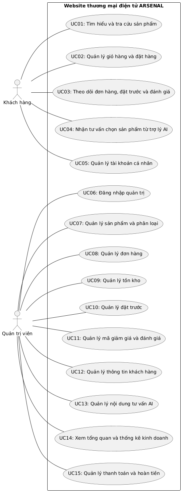

## Phần 3 — Năm sơ đồ phân rã của Khách hàng (UC01–UC05)

### UC01 — Tìm hiểu và tra cứu sản phẩm

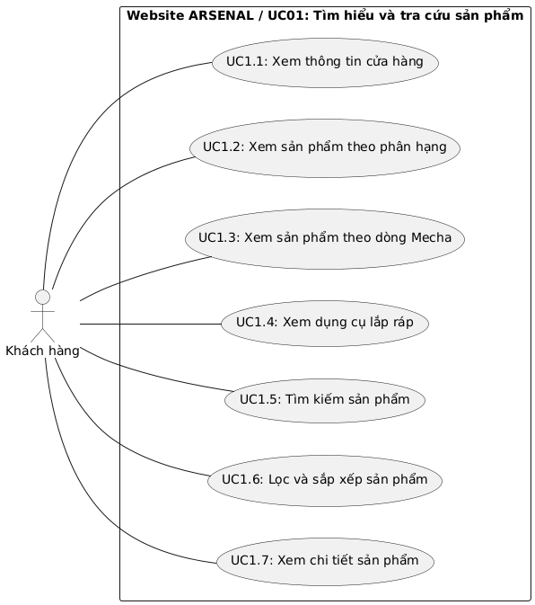

### UC02 — Quản lý giỏ hàng và đặt hàng

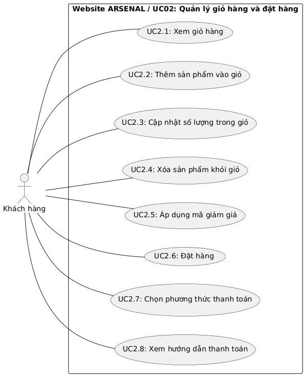

### UC03 — Theo dõi đơn hàng, đặt trước và đánh giá

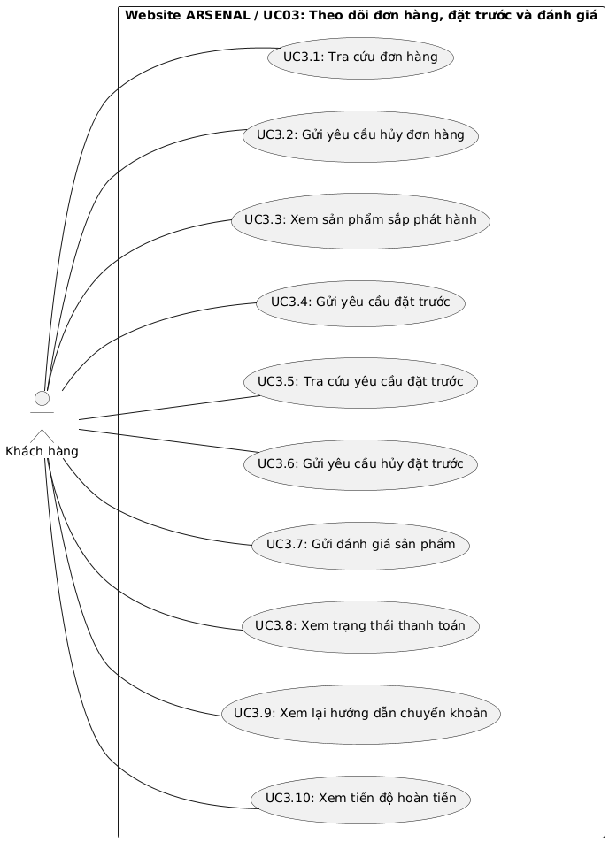

### UC04 — Nhận tư vấn chọn sản phẩm từ trợ lý AI

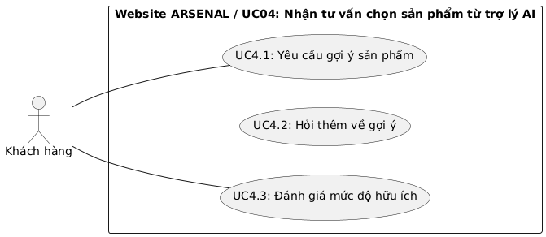

### UC05 — Quản lý tài khoản cá nhân

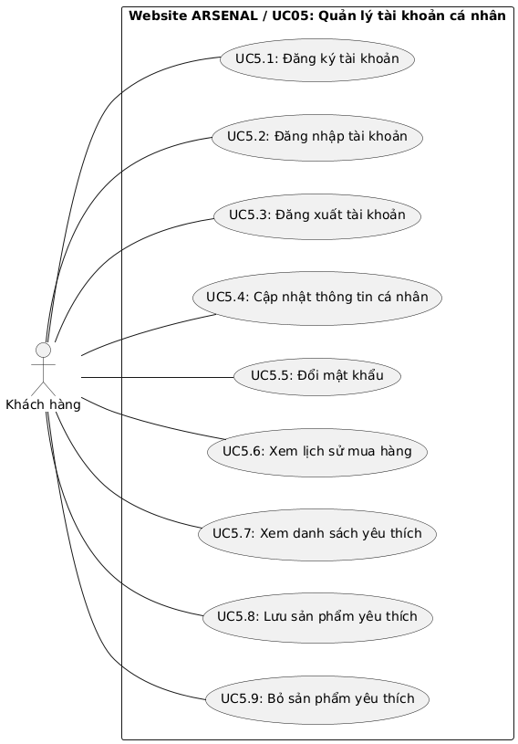

## Phần 4 — Sơ đồ phân rã của Quản trị viên (UC07–UC15)

### UC07 — Quản lý sản phẩm và phân loại

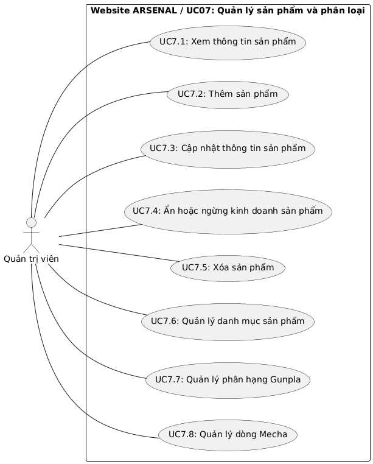

### UC08 — Quản lý đơn hàng

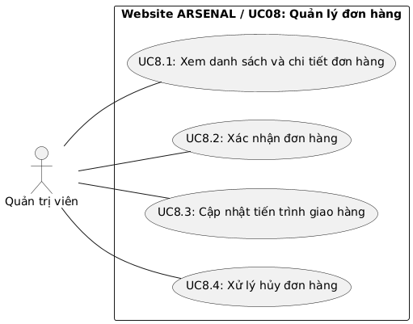

### UC09 — Quản lý tồn kho

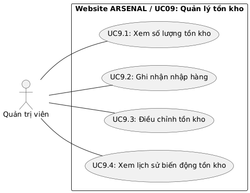

### UC10 — Quản lý đặt trước

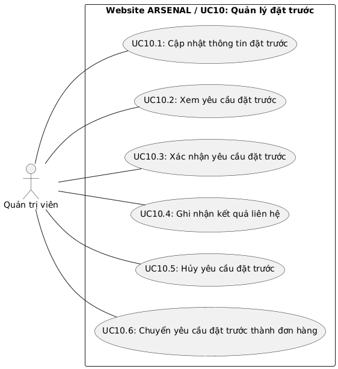

### UC11 — Quản lý mã giảm giá và đánh giá

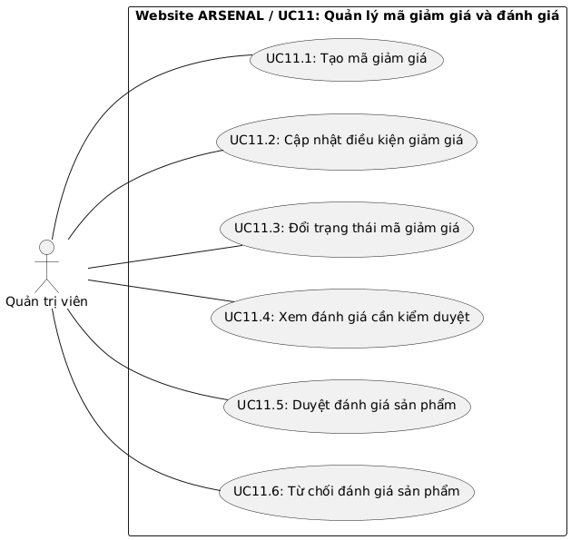

### UC12 — Quản lý thông tin khách hàng

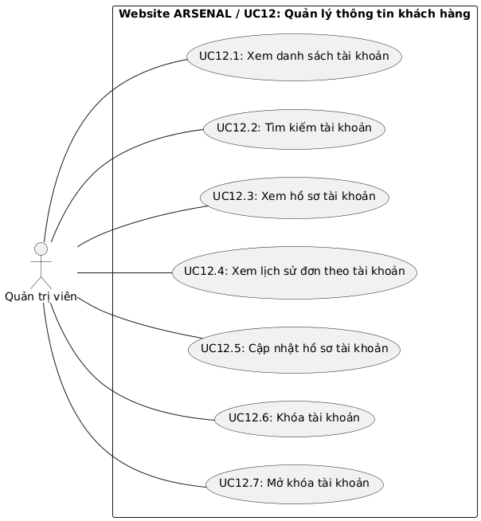

### UC13 — Quản lý nội dung tư vấn AI

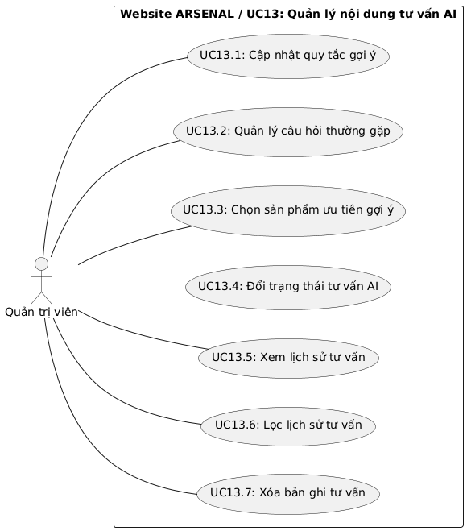

### UC14 — Xem tổng quan và thống kê kinh doanh

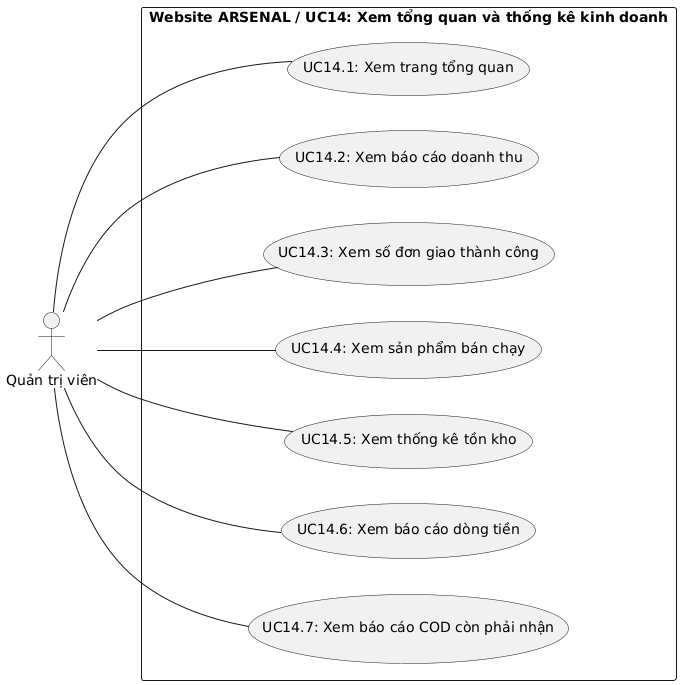

### UC15 — Quản lý thanh toán và hoàn tiền

#### Đối chiếu khoản thu và xử lý quá hạn

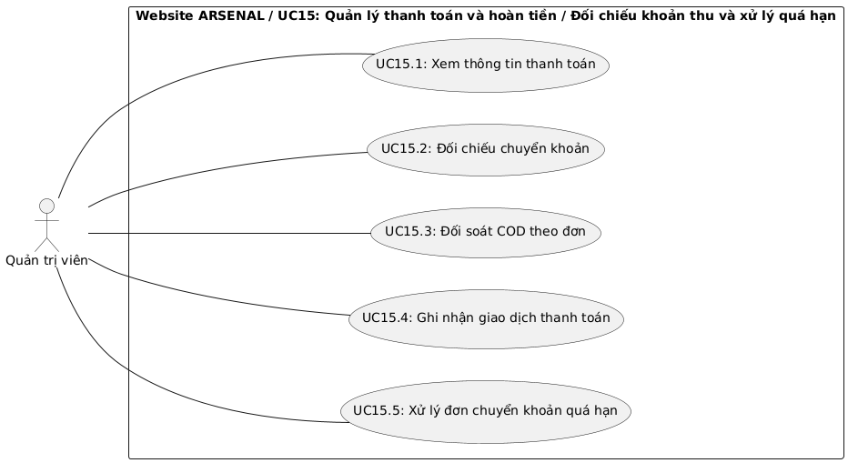

#### Hoàn tiền và nhật ký

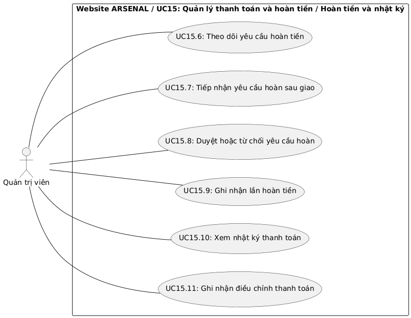

## Phần 5 — Đặc tả kịch bản theo mẫu Bảng 2.1

Mỗi bảng đặc tả một nhóm nghiệp vụ ở mức **tổng quát**. Các mã UCn.k trong bảng chỉ mục tiêu ở mức **chi tiết**. Chuỗi sự kiện chính trình bày một lần thực hiện điển hình. Khi tác nhân chọn một mục tiêu khác trong cùng nhóm, nhánh tương ứng bắt đầu tại bước được ghi và có thể kết thúc độc lập. Mỗi nhánh nêu rõ hệ thống tiếp tục ở đâu hoặc kết thúc với kết quả gì. Bố cục trường theo Bảng 2.1, giáo trình Chương 2, trang 59–60.

### UC01 — Tìm hiểu và tra cứu sản phẩm

| Trường | Đặc tả |
|---|---|
| Tên Use Case | **UC01: Tìm hiểu và tra cứu sản phẩm** |
| Mô tả ngắn gọn | Giúp người mua tìm và đọc thông tin sản phẩm phù hợp trước khi quyết định mua hoặc đặt trước. |
| Tác nhân | Khách hàng. |
| Mức | Tổng quát. |
| Kích hoạt | Khách mở trang chủ hoặc gửi yêu cầu tra cứu sản phẩm. |
| Điều kiện tiên quyết (Pre-condition) | Website công khai truy cập được. Khách có thể bắt đầu khi chưa đăng nhập. |
| Điều kiện kết thúc (Post-condition) | **Thành công.** Khách nhận thông tin cửa hàng, kết quả tra cứu hoặc chi tiết sản phẩm. Khi không có sản phẩm phù hợp, hệ thống hiển thị kết quả rỗng. **Không thành công.** Hệ thống báo không thể tải dữ liệu và cho phép thử lại. |
| Chuỗi sự kiện chính (Main flow) | 1. Khách mở trang chủ để tìm sản phẩm. 2. Hệ thống hiển thị thông tin cửa hàng, sản phẩm mới, sản phẩm nổi bật và các nhóm sản phẩm (UC1.1). 3. Khách nhập tên hoặc từ khóa để tìm sản phẩm (UC1.5). 4. Hệ thống hiển thị các sản phẩm phù hợp. 5. Khách chọn một sản phẩm trong kết quả (UC1.7). 6. Hệ thống hiển thị ảnh, mô tả, giá, thông số, phân loại áp dụng và tình trạng còn hàng. |
| Luồng thay thế / Ngoại lệ | **2a — Duyệt theo phân loại.** Khách chọn phân hạng Gunpla (UC1.2), dòng Mecha (UC1.3) hoặc dụng cụ (UC1.4). Hệ thống hiển thị nhóm tương ứng và cho phép mở chi tiết ở bước 5. Nếu chỉ xem thông tin trang chủ hoặc danh sách, khách có thể kết thúc tại đó. **4a — Lọc hoặc sắp xếp (UC1.6).** Khách chọn danh mục, phân hạng, dòng, khoảng giá hoặc thứ tự theo giá/ngày thêm. Hệ thống cập nhật danh sách. Khách có thể đổi điều kiện hoặc tiếp tục bước 5. **4b — Không tìm thấy sản phẩm.** Hệ thống hiển thị danh sách rỗng và cho phép đổi từ khóa hoặc điều kiện lọc, quay về bước 3 hoặc 4a. **6a — Sản phẩm đã bị ẩn hoặc dữ liệu không tải được.** Hệ thống thông báo không thể hiển thị chi tiết và cho phép trở về danh sách. |
| Ghi chú | Phân hạng, tỷ lệ và dòng Mecha chỉ hiển thị khi áp dụng cho sản phẩm. Nguồn nghiệp vụ là mục 3.1.a–b và 4.1. |

### UC02 — Quản lý giỏ hàng và đặt hàng

| Trường | Đặc tả |
|---|---|
| Tên Use Case | **UC02 – Quản lý giỏ hàng và đặt hàng** |
| Mô tả ngắn gọn | Khách chuẩn bị giỏ, xác nhận đơn và xem cách thanh toán theo phương thức đã chọn. |
| Tác nhân | Khách hàng. |
| Mức | Tổng quát. |
| Kích hoạt | Khách thêm sản phẩm, mở giỏ hoặc bắt đầu đặt hàng. |
| Điều kiện tiên quyết (Pre-condition) | Giỏ có ít nhất một mặt hàng khi khách đặt hàng. Khách vãng lai có thể đặt hàng. |
| Điều kiện kết thúc (Post-condition) | **Thành công.** Giỏ phản ánh thay đổi hợp lệ. Nếu đặt hàng thành công, hệ thống cấp mã đơn, lưu trạng thái Chờ xác nhận và Chưa thanh toán, giữ lượt mã nếu có và hiển thị hướng dẫn thanh toán. **Không thành công.** Hệ thống báo lý do và hoàn tác cả việc tạo đơn và giữ lượt mã nếu giao dịch lưu thất bại. |
| Chuỗi sự kiện chính (Main flow) | 1. Khách thêm sản phẩm và số lượng (UC2.2). Hệ thống kiểm tra số lượng có thể mua và cập nhật giỏ. 2. Khách mở giỏ (UC2.1), xem số lượng, đơn giá và tiền tạm tính. 3. Khách chọn Đặt hàng (UC2.6), nhập họ tên, điện thoại, địa chỉ, email nếu có và chọn COD hoặc chuyển khoản (UC2.7). 4. Hệ thống kiểm tra thông tin, giá và tồn khả dụng. Khách xem tiền hàng, khoản giảm nếu có, phí vận chuyển cố định, tổng tiền và xác nhận đặt hàng. 5. Hệ thống kiểm tra lại điều kiện, lưu đơn, chi tiết mặt hàng theo giá lúc mua và giữ lượt mã nếu có trong cùng giao dịch dữ liệu. Đơn chuyển khoản có hạn 24 giờ kể từ lúc được tạo. 6. Hệ thống hiển thị mã đơn và hướng dẫn để khách xem cách thanh toán (UC2.8). Với COD, khách trả khi nhận hàng. Với chuyển khoản, khách xem tên ngân hàng, chủ tài khoản, số tài khoản nhận của cửa hàng, số tiền, mã đơn dùng làm nội dung và thời điểm hết hạn. |
| Luồng thay thế / Ngoại lệ | **1a – Mở giỏ có sẵn.** Khách bắt đầu ở bước 2. Với giỏ rỗng, hệ thống hướng khách quay lại chọn sản phẩm. **2a – Thay đổi giỏ.** Khách đổi số lượng (UC2.3) hoặc xóa mặt hàng (UC2.4). Hệ thống cập nhật giỏ rồi hiển thị lại tiền tạm tính. **2b – Dùng mã giảm giá (UC2.5).** Hệ thống kiểm tra trạng thái, thời hạn, số lượt, tiền hàng tối thiểu và giới hạn theo số điện thoại đã chuẩn hóa. Nếu mã hợp lệ, hệ thống đưa khoản giảm vào tổng tiền ở bước 4. Nếu mã không hợp lệ, khách chọn mã khác hoặc tiếp tục với giá chưa giảm. **4a – Dữ liệu sai hoặc vượt tồn.** Khách sửa thông tin ở bước 3 hoặc điều chỉnh giỏ ở bước 2. **5a – Điều kiện đã đổi.** Hệ thống báo thay đổi về tồn, giá hoặc lượt mã và yêu cầu khách kiểm tra lại giỏ hoặc xác nhận tổng tiền mới trước khi tạo đơn. **5b – Lỗi lưu.** Hệ thống hoàn tác giao dịch và báo lỗi để khách kiểm tra lại trước khi thử tiếp. |
| Ghi chú | Giỏ khách đăng nhập lưu theo tài khoản, giỏ vãng lai lưu tạm trên trình duyệt. Mã giảm áp dụng cho tiền hàng. Hàng được giữ khi quản trị viên xác nhận đơn ở UC08. Việc ghi nhận tiền thực nhận thuộc UC15. Nguồn nghiệp vụ là mục 3.1.c–d, 4.1 và 6. |

### UC03 — Theo dõi đơn hàng, đặt trước và đánh giá

| Trường | Đặc tả |
|---|---|
| Tên Use Case | **UC03 – Theo dõi đơn hàng, đặt trước và đánh giá** |
| Mô tả ngắn gọn | Khách tra cứu đơn và tình hình thanh toán, theo dõi đặt trước hoặc đánh giá sản phẩm đã nhận. |
| Tác nhân | Khách hàng. |
| Mức | Tổng quát. |
| Kích hoạt | Khách muốn tra cứu, đề nghị hủy, gửi đặt trước hoặc đánh giá. |
| Điều kiện tiên quyết (Pre-condition) | Khách có mã và số điện thoại đã dùng cho giao dịch cần tra cứu hoặc xác minh. Sản phẩm đang nhận đặt trước khi khách gửi yêu cầu mới. |
| Điều kiện kết thúc (Post-condition) | **Thành công.** Khách nhận thông tin tra cứu, mã yêu cầu đặt trước, xác nhận tiếp nhận yêu cầu hủy hoặc đánh giá ở trạng thái Chờ duyệt. **Không thành công.** Hệ thống báo lỗi hoặc yêu cầu xác minh bổ sung. |
| Chuỗi sự kiện chính (Main flow) | 1. Khách chọn Tra cứu đơn hàng (UC3.1). 2. Khách nhập mã đơn và số điện thoại đã dùng khi đặt. 3. Hệ thống kiểm tra tần suất và đối chiếu thông tin. 4. Hệ thống hiển thị trạng thái xử lý và thông tin thanh toán (UC3.8), gồm phương thức, tổng tiền, số đã đối chiếu và số còn thiếu nếu đơn còn phải thanh toán. |
| Luồng thay thế / Ngoại lệ | **1a – Xem hoặc gửi đặt trước (UC3.3, UC3.4).** Hệ thống hiển thị sản phẩm sắp phát hành, giá tham khảo và thời gian dự kiến. Khách chọn đặt trước, nhập số lượng và thông tin liên hệ. Hệ thống kiểm tra điều kiện, lưu Chờ xác nhận và cấp mã yêu cầu. **1b – Tra cứu hoặc đề nghị hủy đặt trước (UC3.5, UC3.6).** Khách cung cấp mã yêu cầu và số điện thoại để xem trạng thái. Khi yêu cầu chưa chuyển đơn, khách có thể đề nghị hủy để quản trị viên xử lý ở UC10. **1c – Gửi đánh giá (UC3.7).** Khách chọn sản phẩm, xác minh bằng mã đơn và điện thoại, rồi gửi điểm sao và nhận xét. Hệ thống chỉ nhận một đánh giá cho mỗi sản phẩm của đơn đã giao thành công. Đánh giá hợp lệ được lưu ở trạng thái Chờ duyệt. **3a – Sai thông tin hoặc vượt giới hạn.** Hệ thống yêu cầu nhập lại hoặc xác minh bổ sung trước khi hiển thị dữ liệu. **4a – Xem lại hướng dẫn chuyển khoản (UC3.9).** Với đơn Chờ xác nhận, còn hạn và chưa đủ tiền, hệ thống hiển thị lại tài khoản, nội dung, hạn và số tiền còn phải chuyển. Khách chuyển thiếu có thể bổ sung trong hạn với cùng mã đơn. **4b – Chờ đối chiếu quá hạn.** Nếu đơn Chờ xác nhận hết hạn mà chưa ghi nhận đủ tiền đúng hạn, hệ thống hiển thị thông báo chờ đối chiếu. Khi đã chuyển nhưng chưa thấy ghi nhận, chuyển thừa, sai nội dung hoặc chuyển muộn, khách liên hệ cửa hàng với mã đơn, số tiền, thời điểm và mã giao dịch hoặc chứng từ nếu có. Quản trị viên đối chiếu theo UC15. **4c – Xem tiến độ hoàn (UC3.10).** Nếu có yêu cầu hoàn, hệ thống hiển thị tiến độ và số đã hoàn, số còn phải hoàn theo yêu cầu đã duyệt hoặc được hệ thống tạo. **4d – Đề nghị hủy (UC3.2).** Nếu đơn Chờ xác nhận, hệ thống tiếp nhận đề nghị để quản trị viên xử lý theo UC08. Với đơn đã xác nhận hoặc đang giao, khách liên hệ cửa hàng. **4e – Lỗi tra cứu hoặc lưu.** Hệ thống báo lỗi tại thao tác tương ứng. Yêu cầu chỉ được báo tiếp nhận khi lưu thành công. |
| Ghi chú | Khách vãng lai có thể tra cứu và gửi đánh giá. Đặt trước chưa phát sinh cọc hoặc giữ hàng. Chứng từ đối chiếu chi tiết dành cho quản trị viên có quyền. Nguồn nghiệp vụ là mục 3.1.d–f, 4.1 và 5.1. |

### UC04 — Nhận tư vấn chọn sản phẩm từ trợ lý AI

| Trường | Đặc tả |
|---|---|
| Tên Use Case | **UC04: Nhận tư vấn chọn sản phẩm từ trợ lý AI** |
| Mô tả ngắn gọn | Giúp khách chọn mô hình và dụng cụ dựa trên trình độ, ngân sách, dòng Mecha yêu thích và tình trạng hàng thực tế. |
| Tác nhân | Khách hàng. |
| Mức | Tổng quát. |
| Kích hoạt | Khách gửi câu hỏi tư vấn, hỏi tiếp hoặc phản hồi về một kết quả đang xem. |
| Điều kiện tiên quyết (Pre-condition) | Chức năng tư vấn được bật. Khi hỏi tiếp hoặc phản hồi, khách có kết quả tư vấn tương ứng. Khách có thể tư vấn khi chưa đăng nhập. |
| Điều kiện kết thúc (Post-condition) | **Thành công.** Khách nhận lời tư vấn kèm gợi ý phù hợp hoặc thông báo hiện không có sản phẩm đáp ứng. Hệ thống lưu bản ghi đã che thông tin cá nhân và phản hồi hữu ích nếu khách gửi. **Không thành công.** Hệ thống thông báo yêu cầu không thể xử lý hoặc bị giới hạn. Nội dung không thể xử lý an toàn không được gửi sang dịch vụ ngoài hoặc lưu vào lịch sử. |
| Chuỗi sự kiện chính (Main flow) | 1. Khách mô tả nhu cầu và gửi yêu cầu gợi ý (UC4.1). 2. Hệ thống kiểm tra tần suất, xử lý thông tin cá nhân và xác định tiêu chí tư vấn. 3. Hệ thống lấy danh sách ứng viên đang kinh doanh, còn hàng theo dữ liệu cửa hàng và gửi dữ liệu đã xử lý đến dịch vụ AI. 4. Hệ thống kiểm tra phản hồi, đối chiếu sản phẩm, giá và tồn theo dữ liệu cửa hàng, rồi lưu câu hỏi và phản hồi đã xử lý cùng nguồn phản hồi. 5. Hệ thống hiển thị lời tư vấn, sản phẩm gợi ý và đường dẫn xem chi tiết hoặc thêm vào giỏ. |
| Luồng thay thế / Ngoại lệ | **2a — Nội dung không thể che an toàn.** Hệ thống đề nghị khách diễn đạt lại ở bước 1. Nếu vượt giới hạn tần suất, hệ thống thông báo và kết thúc lần yêu cầu. **3a — Dịch vụ AI lỗi hoặc quá 15 giây.** Hệ thống sử dụng quy tắc dự phòng theo trình độ, ngân sách và dòng Mecha, ghi nguồn dự phòng và tiếp tục xử lý ở bước 4. **4a — Không có sản phẩm phù hợp.** Hệ thống thông báo kết quả rỗng và có thể mời khách điều chỉnh nhu cầu ở bước 1. **5a — Hỏi tiếp (UC4.2).** Khách bổ sung câu hỏi hoặc tiêu chí. Hệ thống xử lý yêu cầu mới từ bước 2. **5b — Phản hồi hữu ích (UC4.3).** Khách gửi phản hồi. Hệ thống lưu phản hồi nếu bản ghi còn tồn tại. Nếu thao tác lưu lỗi hoặc bản ghi đã hết hạn, hệ thống báo chưa ghi nhận phản hồi. |
| Ghi chú | Hệ thống nhắc khách tránh nhập họ tên, số điện thoại, email và địa chỉ. Giá và tình trạng còn hàng lấy từ dữ liệu ARSENAL. Xem chi tiết và thêm giỏ dùng các mục tiêu UC1.7 và UC2.2. Lịch sử được xóa sau 30 ngày. Nguồn nghiệp vụ là mục 3.1.g, 4.1, 5.3, 5.5 và 6. |

### UC05 — Quản lý tài khoản cá nhân

| Trường | Đặc tả |
|---|---|
| Tên Use Case | **UC05: Quản lý tài khoản cá nhân** |
| Mô tả ngắn gọn | Cho phép khách tạo phiên truy cập cá nhân, cập nhật hồ sơ và sử dụng các tiện ích gắn với tài khoản. |
| Tác nhân | Khách hàng. |
| Mức | Tổng quát. |
| Kích hoạt | Khách chọn đăng ký, đăng nhập hoặc một tiện ích của tài khoản. |
| Điều kiện tiên quyết (Pre-condition) | Đăng ký có thể bắt đầu khi chưa có tài khoản. Đăng nhập cần tài khoản đã đăng ký và được phép hoạt động. Đăng xuất, cập nhật, đổi mật khẩu, xem lịch sử và quản lý yêu thích cần phiên đăng nhập hợp lệ. |
| Điều kiện kết thúc (Post-condition) | **Thành công.** Hệ thống tạo tài khoản, mở hoặc kết thúc phiên, hiển thị dữ liệu cá nhân hoặc lưu thay đổi đúng theo thao tác. **Không thành công.** Hệ thống không mở quyền truy cập khi xác thực thất bại và không áp dụng thay đổi không hợp lệ. |
| Chuỗi sự kiện chính (Main flow) | 1. Khách chọn đăng nhập tài khoản (UC5.2). 2. Hệ thống yêu cầu thông tin đăng nhập và mật khẩu. 3. Khách nhập thông tin và gửi yêu cầu. 4. Hệ thống xác thực, kiểm tra trạng thái tài khoản và giới hạn tần suất. 5. Hệ thống mở phiên đăng nhập, cho phép khách sử dụng các tiện ích của tài khoản. |
| Luồng thay thế / Ngoại lệ | **1a — Đăng ký (UC5.1).** Khách cung cấp họ tên, số điện thoại, email và mật khẩu. Hệ thống kiểm tra dữ liệu, tạo tài khoản và thông báo kết quả, sau đó khách có thể chọn đăng nhập ở bước 1. Nếu dữ liệu không hợp lệ, hệ thống yêu cầu sửa. **1b — Có phiên hợp lệ.** Khách có thể vào thẳng tiện ích tương ứng ở nhánh 5a–5e. **4a — Xác thực thất bại.** Hệ thống thông báo từ chối. Khách được nhập lại ở bước 3 nếu tài khoản còn hoạt động và chưa vượt giới hạn. Tài khoản bị khóa hoặc yêu cầu vượt giới hạn bị từ chối. **5a — Cập nhật hồ sơ (UC5.4).** Khách gửi nội dung sửa. Hệ thống kiểm tra, lưu hồ sơ và trả thông tin đã cập nhật. **5b — Đổi mật khẩu (UC5.5).** Khách cung cấp mật khẩu hiện tại và mật khẩu mới. Hệ thống kiểm tra và chỉ ghi nhận khi hợp lệ. **5c — Xem lịch sử mua (UC5.6).** Hệ thống hiển thị các đơn được liên kết với tài khoản hiện tại, hoặc thông báo danh sách rỗng. **5d — Quản lý yêu thích.** Hệ thống hiển thị danh sách (UC5.7). Khách có thể lưu sản phẩm (UC5.8) hoặc bỏ sản phẩm (UC5.9). Hệ thống cập nhật danh sách cá nhân. **5e — Đăng xuất (UC5.3).** Hệ thống kết thúc phiên hiện tại. **5f — Phiên hết hạn hoặc lỗi lưu.** Hệ thống yêu cầu đăng nhập lại nếu phiên không còn hợp lệ hoặc báo thay đổi chưa lưu nếu xảy ra lỗi. |
| Ghi chú | Mật khẩu lưu dưới dạng băm. Sửa hồ sơ không làm đổi thông tin nhận hàng đã ghi trong đơn cũ. Đơn đặt khi chưa đăng nhập vẫn tra cứu bằng mã và số điện thoại theo UC3.1. Nguồn nghiệp vụ là mục 3.1.e, 3.1.h, 4.1, 5.1, 5.5 và 6. |

### UC06 — Đăng nhập quản trị

| Trường | Đặc tả |
|---|---|
| Tên Use Case | **UC06: Đăng nhập quản trị** |
| Mô tả ngắn gọn | Xác thực tài khoản được cấp quyền để cho phép truy cập khu vực quản trị. |
| Tác nhân | Quản trị viên. |
| Mức | Tổng quát. Luồng dưới đây đặc tả mục tiêu chi tiết UC6.1. Sơ đồ phân rã UC06 nằm ở phụ lục. |
| Kích hoạt | Quản trị viên truy cập màn hình đăng nhập quản trị. |
| Điều kiện tiên quyết (Pre-condition) | Cửa hàng đã cấp tài khoản quản trị và màn hình đăng nhập truy cập được. |
| Điều kiện kết thúc (Post-condition) | **Thành công.** Hệ thống tạo phiên quản trị hợp lệ và hiển thị khu vực quản trị theo quyền. **Không thành công.** Hệ thống không tạo phiên quản trị và từ chối truy cập chức năng cần quyền. |
| Chuỗi sự kiện chính (Main flow) | 1. Quản trị viên mở màn hình đăng nhập (UC6.1). 2. Hệ thống yêu cầu tên đăng nhập và mật khẩu. 3. Quản trị viên cung cấp thông tin và gửi yêu cầu. 4. Hệ thống kiểm tra tần suất, thông tin xác thực, trạng thái tài khoản và quyền quản trị. 5. Hệ thống tạo phiên hợp lệ và hiển thị trang tổng quan cùng các chức năng được cấp quyền. |
| Luồng thay thế / Ngoại lệ | **4a — Sai thông tin.** Hệ thống thông báo đăng nhập không thành công và cho nhập lại ở bước 3 nếu còn được phép thử. **4b — Tài khoản không có quyền hoặc yêu cầu bị giới hạn.** Hệ thống từ chối truy cập và kết thúc lần đăng nhập. **4c — Lỗi xác thực.** Hệ thống báo chưa thể đăng nhập và cho thử lại khi khả dụng. |
| Ghi chú | Phiên quản trị hợp lệ và quyền phù hợp là tiền điều kiện của UC07–UC14. Nguồn nghiệp vụ là mục 2.2, 3.2.a, 4.2, 5.1 và 5.5. |

### UC07 — Quản lý sản phẩm và phân loại

| Trường | Đặc tả |
|---|---|
| Tên Use Case | **UC07: Quản lý sản phẩm và phân loại** |
| Mô tả ngắn gọn | Duy trì dữ liệu sản phẩm bán trên website và các nhóm phân loại dùng khi nhập, hiển thị và lọc sản phẩm. |
| Tác nhân | Quản trị viên. |
| Mức | Tổng quát. |
| Kích hoạt | Quản trị viên yêu cầu xem hoặc thay đổi dữ liệu sản phẩm hay phân loại. |
| Điều kiện tiên quyết (Pre-condition) | Phiên quản trị hợp lệ và có quyền quản lý dữ liệu tương ứng. Sản phẩm phải tồn tại nếu thao tác yêu cầu sửa, ẩn hoặc xóa sản phẩm đó. |
| Điều kiện kết thúc (Post-condition) | **Thành công.** Dữ liệu được hiển thị hoặc lưu đúng thao tác, phân loại đang dùng vẫn truy xuất được và lịch sử đơn hàng được bảo toàn. **Không thành công.** Hệ thống báo dữ liệu sai, bị tham chiếu hoặc lỗi lưu. Thao tác không hợp lệ không làm thay đổi dữ liệu. |
| Chuỗi sự kiện chính (Main flow) | 1. Quản trị viên yêu cầu xem dữ liệu sản phẩm (UC7.1). 2. Hệ thống hiển thị danh sách và thông tin sản phẩm đã chọn. 3. Quản trị viên chọn thêm sản phẩm (UC7.2), nhập mã, tên, mô tả, ảnh, giá, thông số và các thông tin phân loại phù hợp. 4. Hệ thống kiểm tra thông tin, danh mục và trạng thái các phân loại được chọn. 5. Hệ thống lưu sản phẩm, hiển thị dữ liệu mới và áp dụng trạng thái kinh doanh đã chọn. |
| Luồng thay thế / Ngoại lệ | **1a — Quản lý phân loại.** Quản trị viên chọn danh mục (UC7.6), phân hạng (UC7.7) hoặc dòng Mecha (UC7.8), rồi yêu cầu thêm, sửa, ngừng hoạt động hoặc xóa. Hệ thống lưu nếu hợp lệ. Phân loại đang được tham chiếu chỉ được xóa sau khi chuyển các liên kết sang giá trị phù hợp. Nếu ngừng hoạt động, hệ thống giữ dữ liệu cũ và chặn chọn cho sản phẩm mới. **2a — Chỉ xem.** Quản trị viên xem thông tin cần thiết và kết thúc. **3a — Sửa sản phẩm (UC7.3).** Quản trị viên chọn sản phẩm và gửi thông tin thay đổi. Hệ thống kiểm tra, lưu và hiển thị giá trị cập nhật. **3b — Ẩn hoặc ngừng bán (UC7.4).** Hệ thống cập nhật trạng thái và giữ dữ liệu để đối chiếu các đơn cũ. **3c — Xóa sản phẩm (UC7.5).** Hệ thống kiểm tra dữ liệu liên quan trước khi xóa. Nếu đã phát sinh đơn hàng hoặc còn tham chiếu, hệ thống từ chối xóa và hiển thị lựa chọn ẩn hoặc ngừng kinh doanh. **4a — Dữ liệu không hợp lệ.** Hệ thống nêu trường cần sửa và quay về bước nhập tương ứng. **5a — Lỗi lưu.** Hệ thống báo thao tác chưa được ghi nhận. |
| Ghi chú | Danh mục, phân hạng Gunpla và dòng Mecha là ba nhóm riêng. Phân hạng, tỷ lệ và dòng Mecha được để trống khi không áp dụng. Mọi thay đổi lượng tồn có thể bán được ghi vào lịch sử theo UC09. Nguồn nghiệp vụ là mục 3.2.b, 3.2.c, 4.2 và 6. |

### UC08 — Quản lý đơn hàng

| Trường | Đặc tả |
|---|---|
| Tên Use Case | **UC08 – Quản lý đơn hàng** |
| Mô tả ngắn gọn | Quản trị viên tiếp nhận, xác nhận, theo dõi giao và hủy đơn theo trạng thái thực tế. |
| Tác nhân | Quản trị viên. |
| Mức | Tổng quát. |
| Kích hoạt | Quản trị viên xem đơn hoặc cần xác nhận, cập nhật giao hàng hay hủy đơn. |
| Điều kiện tiên quyết (Pre-condition) | Phiên quản trị hợp lệ, có quyền xử lý đơn và đơn đã tồn tại. |
| Điều kiện kết thúc (Post-condition) | **Thành công.** Trạng thái xử lý, lượng tồn và lượt mã được ghi đúng theo thao tác. Khi hủy đơn còn tiền phải trả khách, hệ thống tạo hoặc bổ sung yêu cầu hoàn trong cùng giao dịch dữ liệu. **Không thành công.** Hệ thống báo lý do và hoàn tác các cập nhật thuộc giao dịch chưa hoàn tất. |
| Chuỗi sự kiện chính (Main flow) | 1. Quản trị viên mở đơn Chờ xác nhận (UC8.1). 2. Hệ thống hiển thị người nhận, mặt hàng, tiền hàng, phí vận chuyển và trạng thái xử lý, thanh toán. 3. Quản trị viên chọn xác nhận (UC8.2). Hệ thống kiểm tra trạng thái, tồn khả dụng và phương thức. Với chuyển khoản, tiền thực nhận đúng hạn đã được đối chiếu và đủ tổng tiền phải trả. Với COD, xác nhận có thể thực hiện trước khi nhận tiền. 4. Trong cùng giao dịch, hệ thống chuyển Đã xác nhận, trừ tồn khả dụng, lưu lịch sử kho và chuyển lượt mã đã giữ sang Đã sử dụng nếu có. 5. Hệ thống hiển thị kết quả. |
| Luồng thay thế / Ngoại lệ | **2a – Chỉ xem đơn.** Quản trị viên xem chi tiết và kết thúc. **3a – Cập nhật giao hàng (UC8.3).** Hệ thống cho chuyển Đã xác nhận sang Đang giao hàng, rồi Đã giao hàng khi khách nhận. Giao thất bại mà hàng chưa về thì ghi chú chờ hoàn hàng và tiếp tục ở Đang giao hàng. Kho được trừ tại bước xác nhận. **3b – Hủy đơn (UC8.4).** Quản trị viên kiểm tra điều kiện. Đơn Chờ xác nhận chưa giữ tồn. Đơn Đã xác nhận chưa bàn giao được hoàn lại lượng đã giữ. Đơn giao thất bại chỉ được hủy sau khi cửa hàng nhận và kiểm tra hàng về, cộng lại lượng đủ điều kiện bán và ghi chú phần hỏng. Hệ thống chuyển Đã hủy, hoàn lượt mã đã giữ hoặc đã dùng nếu có và tự tạo hoặc bổ sung yêu cầu hoàn nếu cửa hàng còn tiền phải trả cho khách. Các cập nhật thuộc cùng một giao dịch và chỉ được ghi một lần. **3c – Điều kiện chưa đạt.** Hệ thống báo thiếu hàng, chưa đủ tiền thực nhận đúng hạn hoặc trạng thái đã đổi. Quản trị viên kiểm tra lại đơn và xử lý theo điều kiện tương ứng. **4a – Lỗi lưu.** Hệ thống hoàn tác các cập nhật và hiển thị lại thông tin hiện hành. |
| Ghi chú | Đơn hủy kết thúc xử lý giao hàng. Quản trị viên theo dõi yêu cầu hoàn trong UC15.6 đến khi hoàn đủ. Đơn đã giao giữ trạng thái xử lý khi phát sinh đổi trả trực tiếp với cửa hàng. UC09 ghi nhận hàng trả đủ điều kiện bán. Nguồn nghiệp vụ là mục 3.1.c–d, 3.2.c, 3.2.i, 4.2 và 6. |

### UC09 — Quản lý tồn kho

| Trường | Đặc tả |
|---|---|
| Tên Use Case | **UC09: Quản lý tồn kho** |
| Mô tả ngắn gọn | Cho phép theo dõi lượng hàng còn có thể bán và đối chiếu mọi thay đổi từ nhập, xác nhận đơn, hủy hoặc kiểm kê. |
| Tác nhân | Quản trị viên. |
| Mức | Tổng quát. |
| Kích hoạt | Quản trị viên cần kiểm tra tồn, nhập hàng, điều chỉnh kiểm kê hoặc tra cứu lịch sử. |
| Điều kiện tiên quyết (Pre-condition) | Phiên quản trị hợp lệ và có quyền quản lý kho. Sản phẩm đã tồn tại nếu thao tác áp dụng cho một sản phẩm cụ thể. |
| Điều kiện kết thúc (Post-condition) | **Thành công.** Thông tin tồn hoặc lịch sử được hiển thị. Mỗi lần nhập hay điều chỉnh thành công cập nhật lượng có thể bán và lưu lịch sử tương ứng. **Không thành công.** Hệ thống báo lỗi, lượng tồn và lịch sử không thay đổi nếu giao dịch cập nhật thất bại. |
| Chuỗi sự kiện chính (Main flow) | 1. Quản trị viên chọn sản phẩm cần kiểm tra (UC9.1). 2. Hệ thống hiển thị lượng có thể bán và thông tin đối chiếu lượng đang giữ cho đơn. 3. Quản trị viên ghi nhận nhập hàng (UC9.2), nhập lượng hàng đạt điều kiện bán, ngày nhập và ghi chú nếu có. 4. Hệ thống kiểm tra số lượng và dữ liệu nhập. 5. Hệ thống cộng tồn có thể bán, ghi lịch sử gồm loại biến động, số lượng thay đổi, trước và sau, thời điểm và người thực hiện, rồi hiển thị kết quả. |
| Luồng thay thế / Ngoại lệ | **2a — Chỉ xem tồn.** Quản trị viên đối chiếu số liệu và kết thúc. **3a — Điều chỉnh (UC9.3).** Quản trị viên nhập số lượng tăng hoặc giảm và lý do. Hệ thống kiểm tra lượng tồn sau điều chỉnh không âm rồi lưu biến động. Với hàng trả sau khi đã giao, chỉ cộng lượng thực nhận đã kiểm tra và đủ điều kiện bán. **3b — Xem lịch sử (UC9.4).** Hệ thống hiển thị lần nhập, trừ khi xác nhận, cộng khi hủy và lần điều chỉnh, kèm đơn liên quan nếu có. Quản trị viên xem và kết thúc. **4a — Dữ liệu sai hoặc thiếu lý do bắt buộc.** Hệ thống yêu cầu sửa ở bước 3 hoặc nhánh 3a. **5a — Lỗi lưu hoặc dữ liệu đã thay đổi.** Hệ thống không lưu dở dang, hiển thị lại số lượng hiện tại và yêu cầu kiểm tra trước khi ghi nhận lại. |
| Ghi chú | Tồn khả dụng đã loại lượng đang giữ cho các đơn được xác nhận. Biến động do xác nhận và hủy đơn phát sinh trong giao dịch UC08. Lịch sử kho không được sửa hoặc xóa. Nguồn nghiệp vụ là mục 3.2.c, 4.2 và 6. |

### UC10 — Quản lý đặt trước

| Trường | Đặc tả |
|---|---|
| Tên Use Case | **UC10: Quản lý đặt trước** |
| Mô tả ngắn gọn | Quản lý sản phẩm sắp mở bán, tiếp nhận yêu cầu, theo dõi liên hệ và chuyển yêu cầu đủ điều kiện thành đơn chính thức. |
| Tác nhân | Quản trị viên. |
| Mức | Tổng quát. |
| Kích hoạt | Quản trị viên cập nhật thông tin mở bán, nhận yêu cầu mới hoặc xử lý yêu cầu đến hạn liên hệ, hủy hay chuyển đơn. |
| Điều kiện tiên quyết (Pre-condition) | Phiên quản trị hợp lệ và có quyền quản lý đặt trước. Khi xử lý một yêu cầu cụ thể, yêu cầu đã tồn tại. |
| Điều kiện kết thúc (Post-condition) | **Thành công.** Thông tin đặt trước được hiển thị hoặc lưu đúng thao tác. Nếu chuyển thành công, có đúng một đơn chính thức liên kết với yêu cầu ở trạng thái Đã chuyển thành đơn hàng. **Không thành công.** Hệ thống báo lý do và giữ dữ liệu nhất quán. Lần chuyển không thành công không để lại đơn hoặc trạng thái chuyển dở dang. |
| Chuỗi sự kiện chính (Main flow) | 1. Quản trị viên yêu cầu xem danh sách đặt trước (UC10.2). 2. Hệ thống hiển thị mã yêu cầu, sản phẩm, số lượng, thông tin liên hệ và trạng thái. 3. Quản trị viên mở yêu cầu Chờ xác nhận và yêu cầu xác nhận (UC10.3). 4. Hệ thống kiểm tra thông tin và trạng thái yêu cầu. 5. Hệ thống lưu Đã xác nhận và hiển thị kết quả. |
| Luồng thay thế / Ngoại lệ | **1a — Cập nhật sản phẩm (UC10.1).** Quản trị viên chọn sản phẩm sắp phát hành, cập nhật giá tham khảo, ngày dự kiến và trạng thái nhận đặt trước. Hệ thống kiểm tra, lưu và thông báo kết quả. **2a — Chỉ xem.** Quản trị viên đọc thông tin và kết thúc. **3a — Ghi nhận liên hệ (UC10.4).** Khi sản phẩm phát hành và có hàng, Quản trị viên liên hệ khách của yêu cầu đã xác nhận và ghi nhận kết quả. Hệ thống lưu số lần liên hệ, lần đầu, lần gần nhất, hạn phản hồi và ghi chú. Hạn là 7 ngày từ lần đầu, với tối đa hai lần liên hệ trong thời hạn. **3b — Hủy yêu cầu (UC10.5).** Với yêu cầu chưa chuyển đơn, Quản trị viên kiểm tra đề nghị hủy, phản hồi từ chối mua hoặc việc quá hạn mà khách không phản hồi. Hệ thống ghi Đã hủy nếu điều kiện phù hợp. **3c — Chuyển thành đơn (UC10.6).** Sau khi khách đồng ý và đã cung cấp hoặc xác nhận lại người nhận, điện thoại, địa chỉ, phương thức thanh toán, giá chính thức, phí giao và tổng tiền, Quản trị viên yêu cầu chuyển đơn. Hệ thống kiểm tra yêu cầu hợp lệ, chưa chuyển và đủ hàng tại thời điểm tạo. Hệ thống lưu một đơn Chờ xác nhận và Chưa thanh toán, cập nhật trạng thái và thời điểm chuyển trong cùng giao dịch. Nếu chọn chuyển khoản, hệ thống tính hạn 24 giờ từ lúc tạo đơn chính thức. Nếu đã có đơn, hết hàng hoặc xác nhận chưa đầy đủ, hệ thống báo lý do và không tạo thêm đơn. **4a — Dữ liệu hoặc trạng thái không hợp lệ.** Hệ thống từ chối và hiển thị trạng thái hiện tại để kiểm tra lại. **5a — Lỗi lưu.** Hệ thống hoàn tác giao dịch tương ứng. Khi chuyển đơn, cả việc tạo đơn và đổi trạng thái được hoàn tác cùng nhau. |
| Ghi chú | Đặt trước không thu cọc, không giữ tồn và không bảo đảm giá tham khảo. Đơn chính thức áp dụng lại quy tắc kiểm tra, trừ tồn khi xác nhận ở UC08. Nguồn nghiệp vụ là mục 3.1.f, 3.2.d, 4.2 và 6. |

### UC11 — Quản lý mã giảm giá và đánh giá

| Trường | Đặc tả |
|---|---|
| Tên Use Case | **UC11: Quản lý mã giảm giá và đánh giá** |
| Mô tả ngắn gọn | Giúp cửa hàng kiểm soát điều kiện ưu đãi và quyết định đánh giá nào được công khai. |
| Tác nhân | Quản trị viên. |
| Mức | Tổng quát. |
| Kích hoạt | Quản trị viên yêu cầu tạo, sửa, đổi trạng thái mã hoặc xem, kiểm duyệt đánh giá. |
| Điều kiện tiên quyết (Pre-condition) | Phiên quản trị hợp lệ và có quyền quản lý nghiệp vụ đã chọn. Mã hoặc đánh giá phải tồn tại trước thao tác cập nhật tương ứng. |
| Điều kiện kết thúc (Post-condition) | **Thành công.** Mã giảm giá hoặc kết quả kiểm duyệt được lưu đúng thao tác. Đánh giá đã duyệt có thể hiển thị công khai. **Không thành công.** Hệ thống báo lỗi và giữ nguyên bản ghi chưa cập nhật thành công. |
| Chuỗi sự kiện chính (Main flow) | 1. Quản trị viên yêu cầu tạo mã giảm giá (UC11.1). 2. Hệ thống cung cấp biểu mẫu điều kiện áp dụng. 3. Quản trị viên nhập mã, loại và giá trị giảm, thời hạn, giá trị đơn tối thiểu, mức giảm tối đa nếu có, số lượt tối đa, giới hạn theo điện thoại và trạng thái. 4. Hệ thống kiểm tra dữ liệu và tính hợp lệ của các điều kiện. 5. Hệ thống lưu mã và hiển thị kết quả. |
| Luồng thay thế / Ngoại lệ | **1a — Cập nhật điều kiện (UC11.2).** Quản trị viên chọn mã, chỉnh điều kiện. Hệ thống kiểm tra giới hạn mới với tổng lượt đang giữ và đã dùng, lưu nếu hợp lệ. Số tiền đã giảm của đơn hợp lệ được giữ nguyên. **1b — Đổi trạng thái (UC11.3).** Quản trị viên kích hoạt hoặc ngừng mã. Hệ thống cập nhật khả năng áp dụng cho đơn mới theo điều kiện hiện hành. **1c — Kiểm duyệt (UC11.4–UC11.6).** Quản trị viên xem danh sách và nội dung đánh giá chờ duyệt (UC11.4), sau đó có thể duyệt (UC11.5) hoặc từ chối (UC11.6). Hệ thống lưu Đã duyệt để công khai hoặc Từ chối để giữ ngoài phần hiển thị công khai. Quản trị viên có thể chỉ xem và kết thúc. **4a — Dữ liệu mã không hợp lệ.** Hệ thống báo điều kiện cần chỉnh và trở về bước 3 hoặc nhánh 1a. **5a — Lỗi lưu hoặc bản ghi đã thay đổi.** Hệ thống thông báo và yêu cầu tải lại trước khi xử lý tiếp. |
| Ghi chú | Giới hạn mã theo số điện thoại nhận hàng chuẩn hóa, dùng chung cho khách vãng lai và có tài khoản. Giữ, sử dụng và hoàn lượt diễn ra trong UC02 và UC08. Mỗi sản phẩm trong một đơn đã giao được đánh giá tối đa một lần. Nguồn nghiệp vụ là mục 3.1.c, 3.1.e, 3.2.e, 4.2 và 6. |

### UC12 — Quản lý thông tin khách hàng

| Trường | Đặc tả |
|---|---|
| Tên Use Case | **UC12: Quản lý thông tin khách hàng** |
| Mô tả ngắn gọn | Tra cứu tài khoản, hỗ trợ sửa hồ sơ và điều chỉnh trạng thái sử dụng khi có căn cứ. |
| Tác nhân | Quản trị viên. |
| Mức | Tổng quát. |
| Kích hoạt | Quản trị viên cần tra cứu hồ sơ, xem lịch sử đơn, xử lý yêu cầu cập nhật hoặc xem xét trạng thái tài khoản. |
| Điều kiện tiên quyết (Pre-condition) | Phiên quản trị hợp lệ và có quyền quản lý thông tin khách hàng. Tài khoản tồn tại trước thao tác xem chi tiết hoặc cập nhật. |
| Điều kiện kết thúc (Post-condition) | **Thành công.** Hệ thống hiển thị đúng hồ sơ hoặc đơn liên kết, hoặc lưu đúng thay đổi hồ sơ, trạng thái. **Không thành công.** Hệ thống báo không có kết quả, từ chối thao tác hoặc thông báo lỗi. Dữ liệu không đổi nếu chưa lưu thành công. |
| Chuỗi sự kiện chính (Main flow) | 1. Quản trị viên yêu cầu xem danh sách tài khoản (UC12.1). 2. Hệ thống hiển thị họ tên, số điện thoại, email, ngày đăng ký và số đơn liên kết. 3. Quản trị viên tìm theo họ tên, điện thoại hoặc email (UC12.2). 4. Hệ thống hiển thị tài khoản phù hợp. 5. Quản trị viên chọn hồ sơ cần xem (UC12.3). 6. Hệ thống hiển thị thông tin chi tiết, trạng thái và tùy chọn xem lịch sử đơn liên kết. |
| Luồng thay thế / Ngoại lệ | **2a — Chọn trực tiếp.** Quản trị viên chọn tài khoản trong danh sách và tiếp tục ở bước 5. **4a — Không có kết quả.** Hệ thống hiển thị danh sách rỗng và cho tìm lại ở bước 3. **6a — Xem lịch sử đơn (UC12.4).** Hệ thống hiển thị các đơn liên kết với tài khoản đã chọn, hoặc thông báo chưa có đơn liên kết. **6b — Sửa hồ sơ (UC12.5).** Sau khi kiểm tra yêu cầu của khách, Quản trị viên nhập thay đổi. Hệ thống xác thực và lưu nếu hợp lệ, hoặc yêu cầu chỉnh lại dữ liệu. **6c — Khóa hoặc mở khóa (UC12.6, UC12.7).** Quản trị viên xem xét dấu hiệu vi phạm hoặc căn cứ mở khóa rồi chọn hành động. Hệ thống kiểm tra trạng thái hiện tại, lưu trạng thái mới và trả kết quả. **6d — Lỗi truy cập hoặc lưu.** Hệ thống không hiển thị dữ liệu nếu quyền không còn hợp lệ và không áp dụng cập nhật nếu lưu thất bại. |
| Ghi chú | Quản trị viên không được xem mật khẩu khách hàng. Thông tin nhận hàng của khách vãng lai được tra cứu qua từng đơn ở UC8.1. Nguồn nghiệp vụ là mục 3.2.h, 4.2 và 6. |

### UC13 — Quản lý nội dung tư vấn AI

| Trường | Đặc tả |
|---|---|
| Tên Use Case | **UC13: Quản lý nội dung tư vấn AI** |
| Mô tả ngắn gọn | Cho phép điều chỉnh cách tư vấn và xem phản hồi đã xử lý để cải thiện gợi ý sản phẩm. |
| Tác nhân | Quản trị viên. |
| Mức | Tổng quát. |
| Kích hoạt | Quản trị viên cần thay đổi quy tắc, câu hỏi thường gặp, ưu tiên hoặc trạng thái tư vấn, hay xử lý lịch sử. |
| Điều kiện tiên quyết (Pre-condition) | Phiên quản trị hợp lệ và có quyền quản lý tư vấn. Sản phẩm hoặc bản ghi được chọn phải còn tồn tại khi thực hiện thao tác cụ thể. |
| Điều kiện kết thúc (Post-condition) | **Thành công.** Cấu hình hoặc nội dung được lưu, bản ghi được hiển thị đã che thông tin cá nhân, hoặc bản ghi được xóa theo yêu cầu. **Không thành công.** Hệ thống báo lý do, giữ cấu hình và dữ liệu trước lần thay đổi không thành công. |
| Chuỗi sự kiện chính (Main flow) | 1. Quản trị viên chọn cập nhật quy tắc gợi ý (UC13.1). 2. Hệ thống hiển thị các quy tắc hiện có. 3. Quản trị viên nhập hoặc điều chỉnh quy tắc theo trình độ, độ phức tạp bộ lắp, ngân sách và dòng Mecha. 4. Hệ thống kiểm tra các điều kiện và lưu quy tắc hợp lệ. 5. Hệ thống hiển thị kết quả và áp dụng cấu hình cho lần tư vấn tiếp theo. |
| Luồng thay thế / Ngoại lệ | **1a — Quản lý câu hỏi thường gặp (UC13.2).** Quản trị viên soạn hoặc sửa nội dung. Hệ thống kiểm tra và lưu nội dung hợp lệ. **1b — Chọn sản phẩm ưu tiên (UC13.3).** Quản trị viên đánh dấu hoặc bỏ đánh dấu ưu tiên. Hệ thống lưu thay đổi và áp dụng điều kiện đang bán, còn hàng khi tư vấn. **1c — Bật hoặc tắt tư vấn (UC13.4).** Hệ thống lưu trạng thái và áp dụng cho yêu cầu mới. **1d — Xem hoặc lọc lịch sử (UC13.5, UC13.6).** Hệ thống hiển thị bản ghi đã che dữ liệu cá nhân. Quản trị viên có thể chọn thời gian, từ khóa hoặc mức hữu ích để thu hẹp kết quả. **1e — Xóa bản ghi (UC13.7).** Quản trị viên yêu cầu xóa bản ghi đã chọn. Hệ thống xóa nếu bản ghi còn tồn tại và hiển thị danh sách cập nhật. Nếu bản ghi đã hết hạn, hệ thống thông báo và tải lại danh sách. **4a — Nội dung sai hoặc lỗi lưu.** Hệ thống thông báo trường cần sửa, quay về bước 3 hoặc báo cấu hình chưa được lưu. |
| Ghi chú | Lịch sử được giữ 30 ngày và được xóa định kỳ. Gợi ý cho người mới xét độ phức tạp của bộ lắp và hướng dẫn sản phẩm. Nguồn nghiệp vụ là mục 3.2.g, 4.2 và 6. |

### UC14 — Xem tổng quan và thống kê kinh doanh

| Trường | Đặc tả |
|---|---|
| Tên Use Case | **UC14 – Xem tổng quan và thống kê kinh doanh** |
| Mô tả ngắn gọn | Theo dõi doanh thu sau hoàn, thực thu, thực hoàn, COD còn phải nhận, đơn đã giao, sản phẩm bán chạy và tồn kho. |
| Tác nhân | Quản trị viên. |
| Mức | Tổng quát. |
| Kích hoạt | Quản trị viên mở trang tổng quan hoặc chọn báo cáo. |
| Điều kiện tiên quyết (Pre-condition) | Phiên quản trị hợp lệ, có quyền xem thống kê. Cung cấp kỳ hoặc ngày chốt cho báo cáo tương ứng. |
| Điều kiện kết thúc (Post-condition) | **Thành công.** Hệ thống hiển thị chỉ tiêu và kỳ hoặc ngày chốt đã chọn. **Không thành công.** Hệ thống thông báo điều kiện sai hoặc chưa tải được dữ liệu. |
| Chuỗi sự kiện chính (Main flow) | 1. Quản trị viên mở trang tổng quan (UC14.1). Hệ thống hiển thị số sản phẩm, đơn, đơn chờ xử lý, số tài khoản khách, doanh thu và dòng tiền. 2. Quản trị viên chọn báo cáo doanh thu theo ngày, tháng hoặc năm (UC14.2). 3. Hệ thống tính tiền hàng sau giảm của đơn đã giao và đã thực nhận đủ tiền, ghi nhận tại ngày muộn hơn giữa ngày giao và ngày nhận đủ tiền. 4. Hệ thống ghi giảm tiền hàng hoàn vào ngày thực hoàn hoặc ngày ghi nhận doanh thu nếu đã hoàn trước ngày đó. 5. Hệ thống hiển thị doanh thu phát sinh, tiền hàng hoàn ghi giảm và doanh thu sau hoàn theo kỳ. |
| Luồng thay thế / Ngoại lệ | **1a – Chỉ xem tổng quan.** Quản trị viên xem các chỉ tiêu và kết thúc. **2a – Xem số đơn đã giao (UC14.3).** Hệ thống đếm theo thời điểm giao thành công trong kỳ. **2b – Xem sản phẩm bán chạy (UC14.4).** Hệ thống xếp theo số lượng trong các đơn đã giao của kỳ. Số lượng lấy từ dữ liệu giao hàng. **2c – Xem tồn kho (UC14.5).** Hệ thống hiển thị tồn khả dụng hiện tại. **2d – Xem dòng tiền (UC14.6).** Hệ thống cộng khoản thực nhận đã đối chiếu, gắn với đơn theo ngày nhận và phương thức. Tổng tiền hoàn tính theo ngày thực hoàn và tách tiền hàng, phí vận chuyển, khoản chưa phân bổ. Dòng tiền ròng bằng thực thu trừ thực hoàn. Thu và hoàn của đơn chưa giao hoặc đã hủy thuộc kỳ phát sinh. **2e – Xem COD còn phải nhận (UC14.7).** Theo ngày chốt, hệ thống lọc đơn COD đã giao, lấy tổng phải trả trừ khoản COD đã đối chiếu và phân bổ đến ngày chốt. Hệ thống hiển thị mã đơn, mã vận đơn nếu có, số đã nhận, số còn thiếu, tổng số đơn và tổng tiền còn phải nhận. **3a – Kỳ hoặc ngày chốt sai.** Hệ thống yêu cầu chọn lại. **5a – Kết quả rỗng hoặc lỗi tổng hợp.** Hệ thống hiển thị trạng thái tương ứng và cho phép thử lại khi lỗi. |
| Ghi chú | Doanh thu ghi theo tiền hàng sau giảm. Phí vận chuyển và khoản chưa phân bổ được theo dõi riêng trong dòng tiền. Nguồn nghiệp vụ là mục 3.2.a, 3.2.f, 4.2 và 6. |

### UC15 — Quản lý thanh toán và hoàn tiền

| Trường | Đặc tả |
|---|---|
| Tên Use Case | **UC15 – Quản lý thanh toán và hoàn tiền** |
| Mô tả ngắn gọn | Đối chiếu từng khoản thu, xử lý tiền thiếu, thừa, sai nội dung hoặc quá hạn, theo dõi yêu cầu và các lần hoàn, lưu nhật ký thao tác. |
| Tác nhân | Quản trị viên có quyền thanh toán. |
| Mức | Tổng quát. |
| Kích hoạt | Có tiền về cửa hàng, đơn chuyển khoản cần đối chiếu quá hạn, yêu cầu hoàn, lần thực hoàn hoặc giao dịch cần điều chỉnh. |
| Điều kiện tiên quyết (Pre-condition) | Phiên quản trị hợp lệ, có quyền với thao tác. Để ghi nhận khoản thu hoặc lần hoàn, có chứng từ thực nhận hoặc thực hoàn và đơn liên quan. |
| Điều kiện kết thúc (Post-condition) | **Thành công.** Hệ thống lưu bản ghi và nhật ký, tính lại số thực thu, số phân bổ, số đã hoàn, số còn phải hoàn và trạng thái liên quan. Mọi lần thu, hoàn và điều chỉnh được kiểm tra trùng và giới hạn trong cùng giao dịch lưu. **Không thành công.** Hệ thống báo lý do và hoàn tác cập nhật của thao tác. Khoản chưa đủ căn cứ để gắn đơn tiếp tục được theo dõi trên sao kê hoặc chứng từ. |
| Chuỗi sự kiện chính (Main flow) | 1. Quản trị viên mở đơn, xem số phải trả, các giao dịch đã ghi và phần còn thiếu (UC15.1). 2. Với chuyển khoản, quản trị viên đối chiếu tài khoản nhận, số tiền, thời điểm thực nhận và mã giao dịch trên sao kê (UC15.2). 3. Khi xác minh được khoản thực nhận dương và chưa ghi, quản trị viên ghi nhận giao dịch gắn với đơn (UC15.4). Hệ thống kiểm tra trùng theo tài khoản nhận và mã giao dịch ngân hàng. 4. Hệ thống cộng các khoản đủ điều kiện theo thời điểm thực nhận, tối đa bằng tổng tiền phải trả, phân bổ tiền hàng sau giảm trước rồi đến phí vận chuyển. Hệ thống tính Chưa thanh toán, Đã thanh toán một phần hoặc Đã thanh toán từ số đã phân bổ và lưu mốc thực nhận đủ tiền khi đạt mức phải trả. 5. Hệ thống lưu nhật ký và hiển thị kết quả. |
| Luồng thay thế / Ngoại lệ | **2a – Đối soát COD (UC15.3).** Quản trị viên đối chiếu chứng từ với tiền cửa hàng thực nhận. Hệ thống lưu mã đối soát hoặc chứng từ, mã vận đơn hoặc dòng phân bổ, đơn vị vận chuyển và ngày nhận tiền. Nếu một chứng từ có nhiều đơn, ghi riêng số tiền từng đơn. Kiểm tra trùng theo đơn vị vận chuyển, chứng từ và dòng phân bổ. Thông báo khách đã trả cho bên giao hàng được lưu dưới dạng ghi chú đến khi tiền về cửa hàng. **2b – Sai nội dung hoặc chưa khớp đơn.** Quản trị viên kiểm tra mã đơn, số tiền, thời điểm và mã giao dịch hoặc chứng từ khách cung cấp. Chỉ gắn khoản thu khi xác định được đơn và có căn cứ đối chiếu. Khoản thiếu trong hạn có thể được bổ sung bằng các giao dịch riêng. **2c – Xử lý quá hạn (UC15.5).** Quản trị viên lọc đơn Chờ xác nhận hết hạn và đối chiếu sao kê. Nếu thực nhận đủ chậm nhất tại hạn 24 giờ, đơn tiếp tục xét xác nhận theo UC8.2 kể cả khi đối chiếu sau hạn. Nếu thiếu tiền đúng hạn, quản trị viên thực hiện UC8.4. Hệ thống theo dõi hoàn số tiền còn giữ. **3a – Thiếu căn cứ, khoản trùng hoặc số tiền không hợp lệ.** Hệ thống báo lý do và yêu cầu kiểm tra lại chứng từ. **4a – Khoản phải trả lại.** Tiền vượt số phải trả, đến muộn hoặc xác minh cho đơn đã hủy được ghi vào dòng tiền và đưa vào phần chưa phân bổ cần hoàn. Khi hủy đơn đã thu, hệ thống tạo yêu cầu Chờ hoàn hoặc bổ sung phần chưa hoàn, chưa nằm trong yêu cầu đang xử lý. Quản trị viên theo dõi số tiền cần trả, đã hoàn và còn phải hoàn trong UC15.6. **5a – Yêu cầu hoàn sau giao (UC15.7, UC15.8).** Khách liên hệ cửa hàng với mã đơn, lý do và minh chứng nếu có. Quản trị viên ghi Chờ duyệt, kiểm tra điều kiện hỗ trợ. Số có thể duyệt thêm được giới hạn bởi tiền đã thu sau khi trừ phần đã hoàn và phần còn phải trả của các yêu cầu đang xử lý. Yêu cầu được duyệt chuyển Chờ hoàn, yêu cầu bị từ chối lưu Từ chối. **5b – Ghi nhận lần hoàn (UC15.9).** Sau khi trả tiền mặt hoặc chuyển khoản, quản trị viên ghi tiền hàng, phí giao, khoản chưa phân bổ, phương thức, thời điểm, người thực hiện, lý do và mã giao dịch hoặc phiếu chi. Hệ thống kiểm tra số dương, chứng từ trùng, số được duyệt hoặc cần hoàn và số đã thu còn có thể hoàn. Yêu cầu chuyển Đang hoàn nếu đã hoàn một phần, Đã hoàn xong nếu đã trả đủ. **5c – Xem hoặc điều chỉnh (UC15.10, UC15.11).** Người có quyền xem nhật ký hoặc lập điều chỉnh tham chiếu bản gốc, lý do và chứng từ. Hệ thống ghi việc vô hiệu và bản thay thế nếu có, kiểm tra trùng và giới hạn hoàn, rồi tính lại từ bản ghi còn hiệu lực. |
| Ghi chú | Đơn còn hiệu lực được tính trạng thái hoàn theo tiền đã phân bổ. Hoàn phần thừa hoặc chưa phân bổ cập nhật tiến độ yêu cầu tương ứng. Đơn đã hủy tính mức hoàn theo tổng thực nhận và tổng thực hoàn. Nhật ký tự động ghi người hoặc nguồn thao tác, thời điểm, bản ghi, lý do và trạng thái trước/sau nếu thay đổi. Bản ghi đã xác nhận được lưu nguyên bản. Nguồn nghiệp vụ là mục 3.2.c, 3.2.i, 4.2, 5.1, 5.4 và 6. |

## Phụ lục — Sơ đồ phân rã UC06 Đăng nhập quản trị

UC6.1 mô tả mục tiêu truy cập khu vực quản trị. Nhập thông tin và kiểm tra quyền là các bước trong kịch bản.

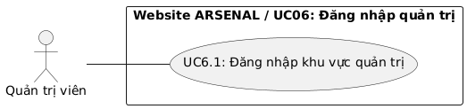
