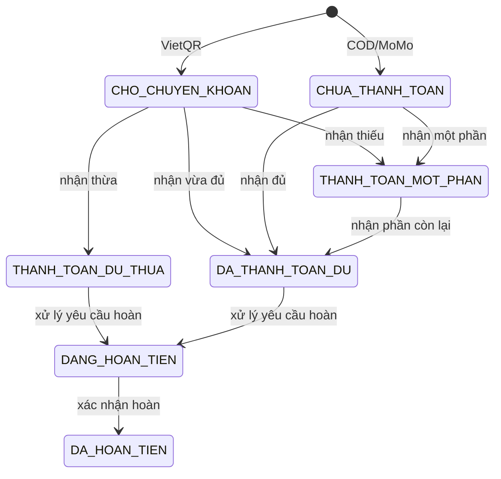

# ARSENAL - Thanh toán và đối soát

## Luồng

```mermaid
sequenceDiagram
    participant KH as Khách hàng
    participant UI as Checkout
    participant API as PHP API
    participant DB as MariaDB
    participant DV as Ngân hàng/MoMo
    participant QTV as Quản trị viên

    KH->>UI: Chọn phương thức và xác nhận tổng tiền
    UI->>API: POST api/dat-hang.php (idempotency requestId)
    API->>DB: Transaction: tạo đơn/chi tiết, giữ coupon
    alt VietQR hoặc MoMo
        API->>DB: Khóa tồn khả dụng + ghi lịch sử kho
    end
    DB-->>API: Commit đơn hàng
    alt VietQR
        API-->>UI: VietQR URL + hạn 24 giờ
        DV->>API: SePay webhook HMAC xác nhận tiền vào
        API->>DB: Ghi nhận giao dịch idempotent; đủ tiền thì tự xác nhận đơn
    else MoMo
        API->>DV: POST create, chữ ký HMAC-SHA256
        DV-->>API: payUrl, qrCodeUrl, deeplink
        API-->>UI: Mở QR/liên kết MoMo
        DV->>API: POST /api/payments/momo/ipn
        API->>API: Xác minh chữ ký + transId idempotency
    else COD
        UI-->>KH: Đơn chờ xác nhận, chưa thu tiền
        QTV->>DB: Xác nhận đã giao
        QTV->>API: POST /api/payments/cod/reconcile
    end
    API->>DB: Transaction: ghi giao dịch, cập nhật số thu/trạng thái/audit
    opt Thu vượt phải trả
        API->>DB: Tạo YeuCauHoanTien cho phần chưa phân bổ
    end
```



Order processing (`trangThaiXuLy`) remains a separate state axis. COD revenue is dated only after both delivery and full reconciliation.

## Cài đặt

1. Import `ARSENAL_MariaDB.sql`, sau đó chạy **một lần** `database/migrations/20261111_payment_reconciliation.sql` trên database `arsenal`.
2. Set VietQR values in `api/config.local.php`: `transfer_bank_code`, `transfer_account_name`, `transfer_account_number`.
3. To enable automatic bank reconciliation, deploy the site at a publicly reachable HTTPS URL, set the SePay HMAC secret in `sepay_webhook_secret` in `api/config.local.php`, then configure a SePay webhook for incoming transfers using JSON and HMAC-SHA256. Point it to `/api/payments/bank/sepay`. The webhook only accepts signed, recent events for the configured receiving account and an exact `ARS-...` order code. Duplicate transaction IDs are ignored; full on-time payment automatically moves a prepaid order to `DA_XAC_NHAN`. Late, cancelled, or unmatched transfers are not auto-confirmed and need follow-up/refund handling. See SePay's [webhook setup](https://docs.sepay.vn/tich-hop-webhooks.html) and [HMAC authentication](https://developer.sepay.vn/vi/sepay-webhooks/xac-thuc) guides.
4. For MoMo Sandbox set `momo_partner_code`, `momo_access_key`, `momo_secret_key`, and the publicly reachable HTTPS `public_base_url`. Leave credentials blank to hide MoMo at checkout. Keep `config.local.php` private.
5. Ensure PHP cURL and Apache `mod_rewrite` are enabled. The API aliases in `api/.htaccess` expose `/api/payments/momo/ipn`, `/api/payments/bank/sepay`, `/api/payments/cod/reconcile`, and `/api/payments/bank/reconcile`.
6. Schedule the worker every few minutes: `D:\xam\php\php.exe D:\xam\htdocs\DoAn2Test\api\jobs\expire-transfer-orders.php`.

The admin reconciliation endpoints require an authenticated admin with `THANH_TOAN` permission and the existing CSRF token. MoMo IPN is authenticated by HMAC-SHA256; successful provider transaction IDs are idempotent. `tblNhatKyThanhToan` is protected against UPDATE and DELETE by database triggers.
